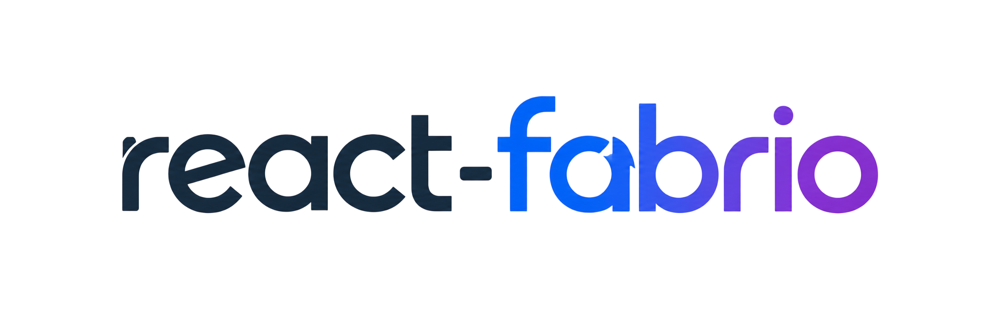
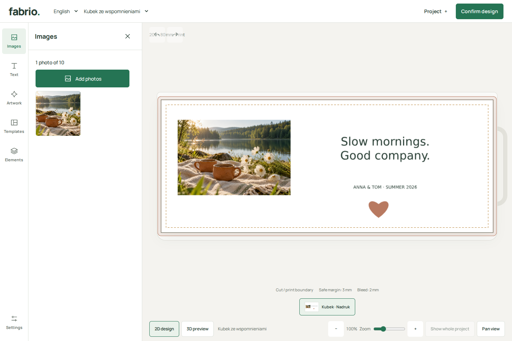
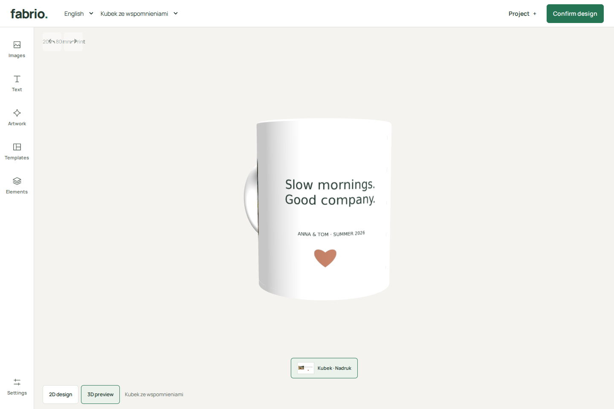
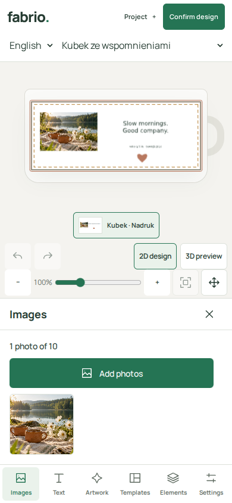

# React Fabrio

<p align="center">
  
</p>

[](https://github.com/Imunal/react-fabrio/actions/workflows/ci.yml)
[](https://codecov.io/gh/Imunal/react-fabrio)

React Fabrio is a React library for building product personalization editors for print and engraving. Configure it for apparel, drinkware, accessories, gifts and other products with customizable decoration areas.

Customers can edit text, images and vector artwork, then preview their design. Fabrio exports PNG files for printing and SVG files for engraving. Use the included editor or build your own interface with the React components.



Turn a photo and a few words into a personal gift. This mug design combines a photograph, editable text and vector artwork in the playground.

| Rotate the mug in 3D                                                                                                                           | Keep creating on mobile                                                                                                                  |
| ---------------------------------------------------------------------------------------------------------------------------------------------- | ---------------------------------------------------------------------------------------------------------------------------------------- |
|  |  |

Try this design: download the [example JSON](.github/assets/readme-design.json), start the playground, and choose **Project → Open design JSON** with the mug selected.

The packages are still in development and have not been published. Run the playground from this repository to try them.

## Get started

You need Node.js 24.11+ and pnpm 12.14.x.

```sh
pnpm install
pnpm dev
```

Open the URL printed in the terminal to try the playground.

## Project structure

```text
apps/
  playground/  Demo application
  docs/        Documentation site and Markdown sources
packages/
  core/        Product definitions, design documents, validation and history
  fabric/      Canvas editing and PNG/SVG output
  react/       Providers, hooks and editor lifecycle
  ui/          Default editor, controls and styles
  three/       Optional 3D mug preview
tests/         Library tests and integration examples
e2e/           Browser tests for editor workflows
scripts/       Repository tools
```

Products define their sides, decoration areas and editing rules through configuration. Designs store geometry in millimeters, independently of the canvas or screen size. Editing, previews and production use the same design document.

The default UI can be replaced with custom React controls. The 3D preview is optional. Your application handles uploads, storage, pricing and checkout. See [architecture](apps/docs/content/architecture.md) for package boundaries.

## Documentation

- [Quick Start](apps/docs/content/quick-start.md)
- [React integration](apps/docs/content/integration.md)
- [Full documentation](apps/docs/content/index.md)
- [Contributing](CONTRIBUTING.md)

## License

[MIT](LICENSE)
